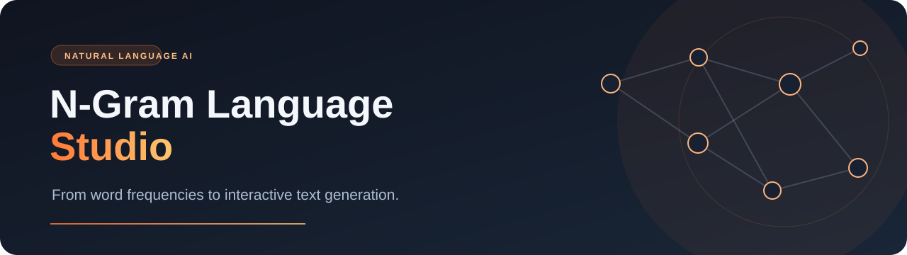
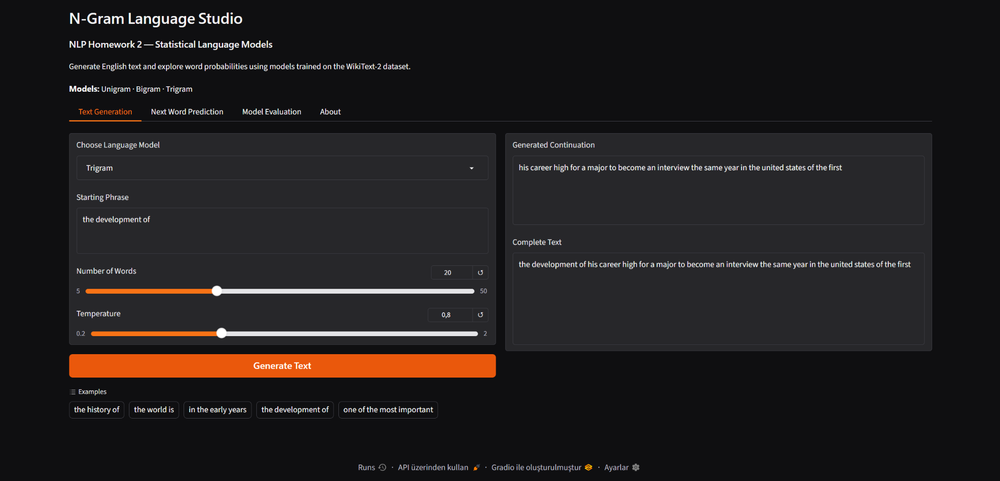
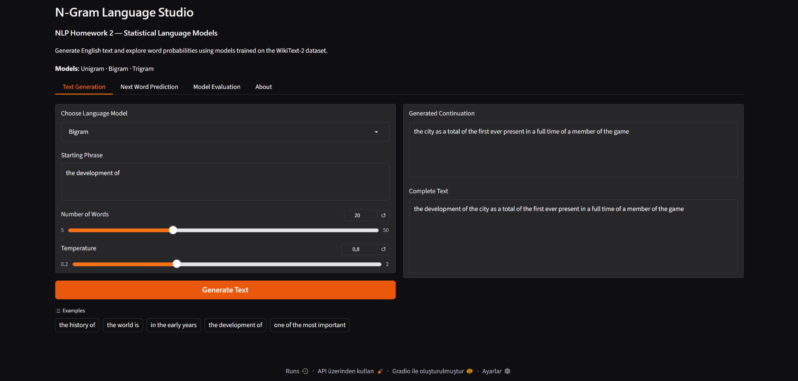
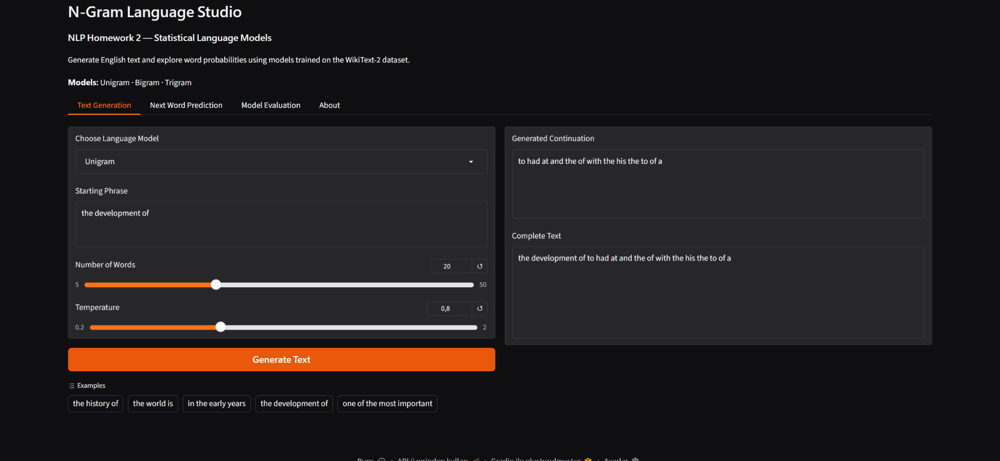
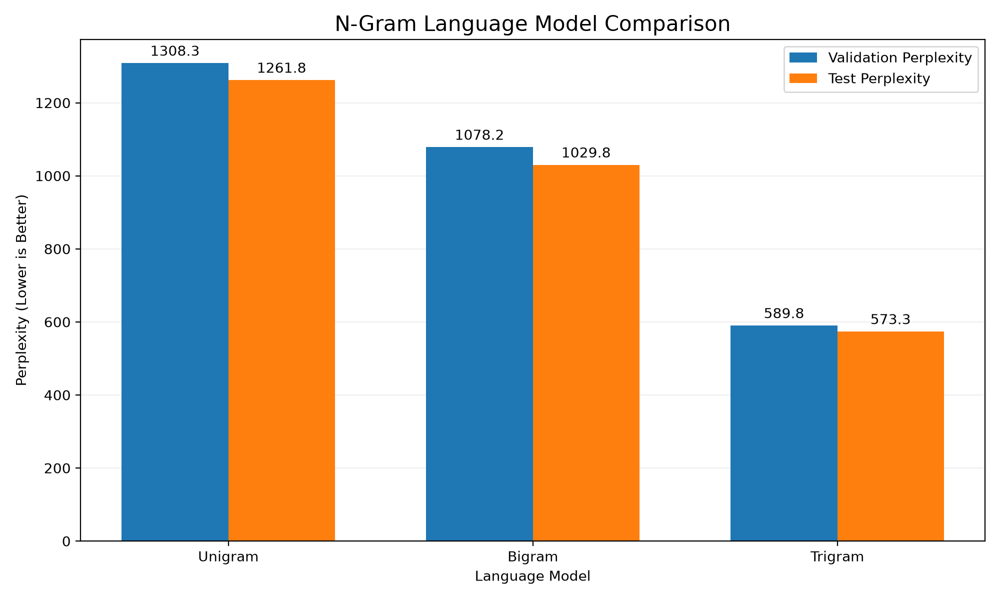
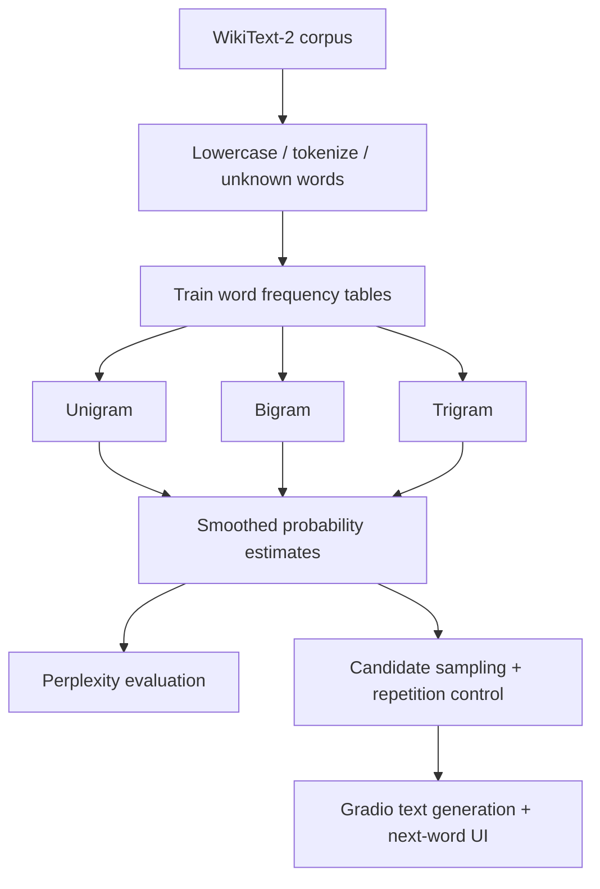

<div align="center">



### Explore how language models predict the next word.

**A from-scratch statistical NLP playground — train, compare, predict, and generate text in your browser.**

[](https://www.python.org/) [](https://www.gradio.app/) [](https://huggingface.co/datasets/Salesforce/wikitext) [](#testing) [](#how-it-works)

[Preview](#app-preview) · [Quick start](#quick-start) · [Results](#model-performance) · [Architecture](#how-it-works)

</div>

---

## The idea

What happens when a text generator learns from **word counts instead of a pretrained LLM**? N-Gram Language Studio is a hands-on implementation of **unigram, bigram, and trigram language models**. It estimates next-word probabilities from WikiText-2, generates continuations, and lets you explore what each model actually learns.

| Text generation | Next-word explorer | Evaluation dashboard |
|:--|:--|:--|
| Enter a phrase, choose a model, tune length and temperature | View the five highest-probability next words | Compare validation and test perplexity |

## App preview

<p align="center"></p>
<p align="center"><sub>Actual Gradio interface · tuned Trigram · text generation</sub></p>

<details><summary><b>Compare generated outputs from the other two models</b></summary>
<br>

<br>

</details>

## Model performance

<div align="center">

| Model | Validation perplexity ↓ | Test perplexity ↓ |
|:--|--:|--:|
| Unigram | 1308.27 | 1261.81 |
| Bigram | 1078.22 | 1029.77 |
| **Tuned Trigram** | **589.80** | **573.35** |



</div>

The Trigram initially scored **1655.57 validation PPL**. Tuning the interpolation's backoff strength on validation data (best of six tested values: **500**) reduced it to **589.80** (about **64.4% lower**). Lower perplexity measures better probability assignments; it **does not guarantee** fluent long-form prose.

## Quick start

**Requirements:** Python 3.12 and an internet connection only if downloading WikiText-2 for retraining. The repository contains the trained models.

```powershell
git clone https://github.com/melisaaydin/ngram-language-studio.git
cd ngram-language-studio
python -m venv .venv
.\.venv\Scripts\python.exe -m pip install -r requirements.txt
.\.venv\Scripts\python.exe app.py
```

Open **http://127.0.0.1:7860**. The model files are loaded locally; no API key or hosted inference service is required.

**macOS / Linux**

```bash
python3 -m venv .venv
source .venv/bin/activate
pip install -r requirements.txt
python app.py
```

## How it works



- **Unigram:** Uses overall word frequencies.
- **Bigram:** Conditions on one preceding word.
- **Trigram:** Conditions on the previous two words.
- **Probability estimation:** Add-k smoothed unigram baseline with recursive interpolation/backoff for higher-order models.
- **Generation:** Context-aware candidate shortlist, temperature sampling, repeated-trigram blocking, and a repetition penalty. Early end-of-sentence is suppressed for the first few generated words.

## Dataset and experimental setup

Source: [WikiText-2 (raw)](https://huggingface.co/datasets/Salesforce/wikitext), configuration `wikitext-2-raw-v1`.

| Split | Non-empty text sequences after preprocessing |
|:--|--:|
| Train | 17,555 |
| Validation | 1,841 |
| Test | 2,183 |

Training contains **1,718,622 word tokens**. The preprocessing vocabulary has **40,460** entries; trained model vocabularies also include a sentence-end marker, for **40,461** entries. Validation was used for tuning. The reported test scores are recorded in `data/training_results.json`.

## Train and evaluate from scratch

The trained models are included, so these commands are **optional**. In the project root:

```powershell
.\.venv\Scripts\python.exe prepare_data.py
.\.venv\Scripts\python.exe train.py
.\.venv\Scripts\python.exe tune_model.py
.\.venv\Scripts\python.exe evaluate.py
```

> `prepare_data.py` regenerates `data/prepared_data.json` locally; this large file is intentionally not committed. **Run `tune_model.py` after `train.py`**: training overwrites the tuned Trigram with the initial hyperparameters. Rerun the app to load updated models.

## Testing

```powershell
.\.venv\Scripts\python.exe -m pytest test_model.py -v
```

The suite has **30 tests** covering probability normalization, training, unknown words, ordering of suggestions, generation, perplexity, serialization, reproducibility, and basic repetition checks.

## Project structure

```text
ngram-language-studio/
├── assets/                  # Banner and real application screenshots
├── data/                    # Small evaluation/tuning JSONs
├── models/                  # Pretrained unigram, bigram, trigram models
├── results/                 # Evaluation plot
├── app.py                   # Gradio interface
├── language_model.py        # Statistical LM implementation
├── prepare_data.py          # Corpus download and preprocessing
├── train.py                 # Train + evaluate all three models
├── tune_model.py            # Validation-based trigram tuning
├── evaluate.py              # Perplexity visualization
├── test_model.py            # Test suite
├── REPORT.md                # Full technical write-up
└── requirements.txt
```

## Limitations and safety

This is a **statistical learning project**, not a conversational or semantic language model. Local coherence is sometimes good, but longer continuations may drift or repeat. The reported perplexity is for the **probability model**, not the repetition-penalized sampling distribution. Serialized `.pkl.gz` models use Python pickle: **only load models from trusted sources**.

For implementation notes and the full analysis, see [REPORT.md](REPORT.md).
